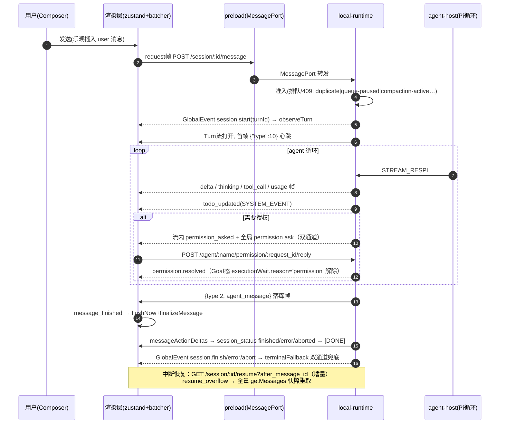

# MCODE 前端模型工作流全链路逆向分析报告

> 日期：2026-10-16 ｜ 对象：MCODE（MiniMax Code 桌面版，Electron 44 + Next.js 渲染层）
> 代码样本：`C:\Users\admin\AppData\Local\Temp\mcode-src`（dist/main 可读编译产物 + @mavis 源码包 + out/_next 渲染层静态导出）
> 方法：静态逆向。主进程与 @mavis 包可直接阅读；渲染层无 sourcemap，通过事件名字符串在 chunks 中回搜定位。
> ⚠️ 本报告为调研产出，零代码改动。Chat/Work/Review 模块现有样式不受影响。

---

## TL;DR

MCODE 的 agent 事件**不走传统 Electron IPC 推送**，而是渲染层 ↔ utility 进程之间 MessagePort 上的**"伪 HTTP/SSE"**：渲染层用 fetch-shim 发标准 HTTP 语义请求，帧协议 v2 封包过 MessagePort，local-runtime（Node utility process）返回 SSE 语义字节流。共**两条事件流**：

1. **Turn 流**（每轮对话）：`POST /session/:id/message` 的 SSE 响应，携带 delta/tool_call/permission 等帧；
2. **GlobalEvent 流**（全局会话生命周期）：34 种闭目录事件（session.*、permission.*、todo/goal 等），双端终态兜底。

渲染层 zustand 单 store 消费，**16ms/64KB 双阈值 batcher** 合帧提交，流式块仅 `text`/`thinking` 两种，tool/todo/permission/diff 各走独立通道。

---

## 1. 总体架构：三层数据面

```mermaid
flowchart LR
    subgraph 渲染层["渲染层（Next.js out/_next）"]
        UI["React 组件树<br/>消息块/工具卡/审批卡"]
        STORE["zustand store<br/>74835 chunk"]
        SHIM["fetch-shim<br/>runtime-transport/fetch-shim.ts"]
    end
    subgraph 主进程["Electron 主进程（仅端口搬运）"]
        PRE["preload.js<br/>runtimeTransportAPI"]
        UPM["utility-process-manager<br/>connectRenderer :509-554"]
    end
    subgraph UTILITY["utility 进程（数据面所在）"]
        US["utility-server wirePort :190-224"]
        LR["local-runtime-v2<br/>session.controller / conversation-application"]
        AH["turn-system agent-host<br/>（Pi 类 agent 循环）"]
    end
    UI --> STORE
    STORE --> SHIM
    SHIM -- "request 帧" --> PRE
    PRE -- "MessagePort (direct)" --> UPM
    UPM -. "port1" .-> US
    US --> LR --> AH
    AH -- "STREAM_RESPI 事件" --> LR
    LR -- "SessionStreamFrameView" --> US
    US -- "stream-chunk 帧" --> PRE
    PRE -- "Response.getReader()" --> SHIM
    SHIM -- "SSE 字节流" --> STORE
```



关键结论（证据）：

- **主进程不碰数据面**。[utility-process-manager.js:509-554](file:///C:/Users/admin/AppData/Local/Temp/mcode-src/dist/main/modules/local-runtime/utility/utility-process-manager.js) `connectRenderer()` 建 `MessageChannelMain`，port1 给 utility、port2 经 `webContents.postMessage('runtime:transport-port')` 给渲染层，源码注释明言 "Main holds no reference afterwards — the data plane is renderer <-> utility only"。
- **preload 持端口**（MessagePort 不能过 contextBridge）：[preload.js:1002-1128](file:///C:/Users/admin/AppData/Local/Temp/mcode-src/dist/main/preload.js) 暴露 `window.runtimeTransportAPI = {requestPort, getCurrent, requestSwitch, post, subscribe, subscribeLost}`；`runtime:transport-lost` 广播触发端口吊销（:1083-1085）；支持 `direct`（MessagePort）与 `protocol`（app:// 协议）双模式回退（:1013-1032）。
- **fetch-shim 合成标准 Response**（[runtime-transport/fetch-shim.ts](file:///C:/Users/admin/AppData/Local/Temp/mcode-src/node_modules/@mavis/shared/src/runtime-transport/fetch-shim.ts)）：`.ok/.headers/body.getReader()` 齐全，SSE 解析器零改动即可复用——这是"伪 HTTP"设计的核心收益。

## 2. 传输机制：帧协议 v2

| 机制 | 规则 | 证据 |
|---|---|---|
| 帧型（上行） | `request{id,method,url,headers,body,streamWindow}` / `stream-credit` / `abort` | @mavis/shared/src/runtime-transport/frames.ts:21-116 |
| 帧型（下行） | `response-start(seq=0)` / `stream-chunk(seq+1)` / `stream-done` / `stream-error` | 同上 |
| 流控 | credit 窗口默认 **16**、上限 **256** | frames.ts:24-27 |
| 乱序保护 | seq 单调递增，用于去重与 resume 校验 | frames.ts:12-15 |
| 错误映射 | aborted→499；其他→502 `local_runtime_unavailable` | frames.ts:96-101 |
| GlobalEvent 流保护 | 30s 心跳 + 256 帧 pending 背压**断流不重放** | local-runtime-v2/src/http/controllers/events.controller.ts:14-16,70-75 |
| Turn 流保护 | 每帧附 `cursor`；`resume` 带 `after_message_id` 增量续传 | session-stream-delivery.ts:184-193 |
| 消费端合帧 | **16ms setTimeout + 单批 64KB 上限强制 flush** | chunks/74835 batcher `ds()` |

## 3. 事件目录（完整清单）

### 3.1 GlobalEvent（34 种，闭目录）

定义：[global-events.ts:6-41](file:///C:/Users/admin/AppData/Local/Temp/mcode-src/node_modules/@mavis/shared/src/global-events.ts)（名称）、:152-329（payload map）。发布侧统一 stamp `source:'local-runtime'`（local-runtime-v2/src/application/events.ts:35）。

| 分组 | 事件 | 关键 payload |
|---|---|---|
| 会话生命周期 | `session.created` | sessionId/agentName/sessionType(root\|branch)/parentSessionId |
| | `session.start` | turnId/source/queueItemIds |
| | `session.finish` / `session.error` / `session.abort` | status: finished\|error\|aborted\|interrupted + errorCode/errorSource/errorDetail/errorProviderId（:66-79） |
| | `session.deleted` / `session.title_updated` / `session.model_updated` / `session.interaction_mode.changed` | model_updated 含 providerId/modelId/variant/thinking/contextLimit |
| 排队 | `session.queue.updated` | status 9 态 + admissionReason（:201-236） |
| 压缩 | `session.compaction.started/completed/failed` | compactionId/tokensBefore/tokensAfter/tokenUsage{…incomplete}（:45-52,237-251） |
| 重试 | `session.llm_retry` / `content.retry.exceeded` | 重试 UI 依据 |
| 权限 | `permission.ask` | requestId/toolName/ruleContents/toolInput/allowAlwaysSupported（:253-266） |
| | `permission.resolved` | decision: allowAlways\|allowOnce\|deny |
| 问卷 | `questionnaire.ask/dismiss/superseded` | 问卷卡 |
| Goal | `thread_goal.updated/cleared/objective_updated_steering` | status 6 态 + statusReason 26 种 + executionWait 8 种 wait reason（:81-149） |
| 其他 | `message.rewind`（contextReset→上下文重置通知）、`agent.created/updated`、`workspace.git.changed`、`notification.*`、`rotation.completed`、`config.*.changed`、`session.visibility_updated/pinned_updated` | — |

### 3.2 Turn 流帧（SessionStreamFrameView.dataJson 内 JSON）

产帧：`local-runtime-v2/src/application/conversation/session-stream-delivery.ts`。

| 帧 | 含义 | 位置 |
|---|---|---|
| `{"type":10}` | 首帧心跳 | :35 |
| `{type:2, agent_message}` | 消息落库帧（定稿） | :110-115 |
| `{type:'session_status', …}` | started/finished/error/aborted 终态 | :116-131,322-342 |
| `resume_overflow` | 要求渲染层放弃增量、全量重取 | :109 |
| `query_collapse_view` / `generic` / `action_required` | 视图折叠 / 原样透传 | :101-132 |
| `messageActionDeltas` | turn 终止前置帧 | :169-176 |
| `[DONE]` | 终止帧 | :62 |

透传的 runtime delta 词表（渲染层 74835 chunk 实测命中）：`delta(content/chunkIndex)`、`text`、`thinking(content/chunkIndex)`、`tool_call`、`usage`、`todo_updated(todos)`、`complete_message(finishReason)`、`attachment`、`permission_asked`、`permission_replied`、`question_asked/question_replied`、`part_removed(partID)`、`queue_fallback`、`queue_paused`。

### 3.3 底层协议枚举

[messages](file:///C:/Users/admin/AppData/Local/Temp/mcode-src/node_modules/@mavis/protocol/src/generated/archon_protocol.ts)：`RuntimeEventType`(:124-131) STREAM_RESP=1/ACTION_REQUIRED=2/SESSION_STATUS=3/TURN_TERMINAL=4/DEBUG_TRACE=5/MESSAGE_PERSISTED=6；`RespDataType`(:178) AGENT_MESSAGE=2/AGENT_MESSAGE_CHUNK=6/HEARTBEAT=10；`MsgType`(:189) AGENT_CONTENT=1/AGENT_TOOL_CALL=2/SYSTEM_EVENT=3——**todo 即 SYSTEM_EVENT 包 `{"eventType":"todo_updated","todos":[…]}`**（agent-tools/src/cloud/cloud-todowrite.ts:135-155）。

### 3.4 关键 payload 结构（thrift 契约）

[desktop-service/types.ts](file:///C:/Users/admin/AppData/Local/Temp/mcode-src/node_modules/@mavis/thrift-gen-client/src/generated/desktop-service/types.ts)：`SessionMessageView`(:640-664，msgId/msgType/role/thinkingContent/toolCalls/usage/turnId/queryKey/forkOrigin)、`SessionToolCallView`(:564-571，toolName/toolCallId/toolCallStatus/toolCallArgs/toolCallResultData)、`SessionStreamFrameView`(:674-679，cursor/eventJson/dataJson/messageActionDeltas)、`GetMessagesResp`(:698-707，messages/nextCursor/hasMore/**todosJson**/queryCollapseViews/turnResults)。

## 4. 渲染层消费映射

| 关注点 | chunk | 证据 |
|---|---|---|
| 状态库 = **zustand** 单 store | 74835（9 个 chunk 含 zustand 标记） | store actions：`observe/setTodos/finalizeMessage/swapMsgId/upsertToolCall/addChildSession/setPermission/setQuestion/upsertView/applySessionStatus/removePartByCallId` |
| API client + SSE 帧解析器 | 90321 | `h()`：`query_collapse_view`/`heartbeat`/`error{errorCode,errorSource}`/`session_status` 白名单，其余包 `{type:'generic',generic:{eventType,data}}`；`getMessages` 读 `X-Next-Cursor`；`resumeSession` 带 `after_message_id+drain_queued` |
| 流消费者 + batcher | 74835 | `"delta"→pushDelta/appendStreamBatch(kind:"text")`、`"thinking"`、`"tool_call"→upsertToolCall(START/FINISHED/FAILED)`、`message_finished→flushNow+finalizeMessage`、`generic.eventType`：`resume_overflow→flushNow+overflowed`、`session.spawned→addChildSession`、`permission_asked→setPermission(addCard)` |
| 传输引导 | 76208/7015/24831 | `window.runtimeTransportAPI.requestPort()`，protocol 模式回退 |
| GlobalEvent 订阅 | 61057219/74835/90321 | `subscribeGlobalEvents`；`session.finish/error/abort→terminalFallback({terminalSource:"eventbus"})` |
| **diff 不走事件流** | routes.ts:46174,47487 | 独立 REST：`GET /session/:id/turn-diff` |
| msgId 换绑 | 74835 | 临时 id→真实 id：`swapMsgId + dispose 旧 batcher + createBatcher(t)` |
| markdown | b3ef812f/28122/93548/78648/76941 | react-markdown/remark（渲染时机**推测**随 16ms batch 提交驱动，message_finished 后定稿） |

**流式块仅两种**：`text` / `thinking`（appendStreamBatch）。工具卡、todo、permission/question 卡、diff 均不走流式拼帧，各有独立通道（upsert / REST）。

## 5. 编排规则：一轮对话完整时间线



**节点依赖与编排要点**：

1. **准入是第一道闸**：409 六种拒绝码（invalid-session/priority-blocked/queue-paused/ingress-conflict/duplicate/compaction-active，session-stream-delivery.ts:381-420）先于一切事件。
2. **permission 是打断点**：流内 `permission_asked` 与全局 `permission.ask` 双通道投递；Goal 执行态 `executionWait.reason='permission'`（global-events.ts:109-117），turn 侧 ACTION_REQUIRED 挂起直至 resolved。
3. **终态双通道**：Turn 流内 `session_status` + 全局 `session.finish/error/abort`；渲染层 `sendSawTerminalStatus` 检查 + `terminalFallback` 防 SSE 断流后状态悬挂。
4. **增量与全量互斥恢复**：正常续传走 `after_message_id` 增量；`resume_overflow`/重放溢出则整体放弃增量、全量 `getMessages`（响应含 `todosJson`/`queryCollapseViews`/`turnResults`，一次拉平状态）。
5. **temp→real msgId 换绑**：乐观渲染用临时 id，落库帧到达后 `swapMsgId` 换绑并重建 batcher——保证流式过程不因 id 变化断流。
6. **事件投递有序性由 turn-system 保证**：`events/required-agent-event-delivery.ts:95-100` 有 turn-sequence/runtime-sequence 校验。

## 6. 数据流转路径（逐跳）

```
用户输入(Composer)
  → zustand 乐观插入 [74835]
  → api sendMessage [90321]
  → fetch-shim [@mavis/shared/src/runtime-transport/fetch-shim.ts]
  → window.runtimeTransportAPI.post(request帧) [preload.js:1113-1118]
  → MessagePort → utility-server wirePort() [utility-server.js:190-224]
  → isRuntimeTransportServerFrame 校验 [utility/index.js:599-612]
  → local-runtime-v2 session.controller → conversation-application.ts:138-288 (准入)
  → turn-system agent-host (Pi 类 agent 循环, seq 校验)
  → SessionFrame 异步流 → session-stream-delivery.ts mapV2SessionFrames
  → SessionStreamFrameView → stream-chunk 帧过 port
  → preload port.onmessage [preload.js:1070-1079]
  → SSE 解析器 h() [90321] → 流消费者 [74835]
  → batcher ds() 16ms/64KB → zustand store
  → React 组件树渲染（text/thinking 流式块；tool/todo/permission 独立通道；diff 走 REST turn-diff）

旁路：GlobalEvent SSE（同一 utility 内 events.controller）→ subscribeGlobalEvents → 状态机/横幅/审批卡
旁路：主进程仅参与端口建立 / runtime:transport-lost 广播 / app:// 协议回退
旁路：@mavis/remote-control-bridge(event-frame-mapper) 把同一 GlobalEvent 目录投影给手机端——佐证事件目录即产品级契约
```

## 7. 对 open-plan 的借鉴映射

| MCODE 做法 | open-plan 现状（对照） | 可借鉴点 |
|---|---|---|
| 增量恢复：`after_message_id` + `resume_overflow` 全量重取，两者互斥、语义清晰 | 首连固定回放最近 300 条通道事件（server/index.mjs:4767），运行中恢复无"从 Run 起点重放"的语义 | 恢复协议引入"游标 or 全量"二选一，配合 Run 起点（详见恢复差异报告 F3） |
| 终态双通道兜底（Turn 流 + GlobalEvent） | `run_finished` 幂等注入已有雏形（ChatPanel:1688-1691 注释），但依赖轮询找回 | 把"终态兜底"升级为独立生命周期流，防 SSE 断流悬挂 |
| 16ms/64KB batcher | 前端逐事件 setState（token 高频直更） | 引入合帧层降低高频 token 重渲（纯客户端增量，flag 门控） |
| todo 走 SYSTEM_EVENT 单独通道 + 快照随 `GetMessagesResp.todosJson` 下发 | Todo 以 run.steps 为唯一事实来源（ChatPanel:1688-1689），恢复侧 `setTodoItems([])` 清空 | 恢复时随 Run 快照下发 todos，而非清空 |
| diff 走独立 REST 不占事件流 | 工具输出内联事件流 | 大块产物（diff/文件）REST 化，减事件流体积 |
| msgId 乐观换绑（swapMsgId） | 临时 id + 恢复期"锚点错配"（ChatPanel:1105） | 恢复期续写判定加 runId 归属校验（F5） |

---

## 附录：证据文件索引

- 主进程：`dist/main/preload.js`（1002-1128、1070-1079、1113-1118、266-270、1083-1085）、`dist/main/modules/local-runtime/utility/utility-process-manager.js`（509-554）、`dist/main/modules/local-runtime/utility/control.js:26`
- 共享包：`@mavis/shared/src/global-events.ts`（6-41、45-52、66-79、81-149、152-329）、`@mavis/shared/src/runtime-transport/frames.ts`（12-15、21-116、24-27、96-101）、`fetch-shim.ts`
- runtime：`local-runtime-v2/src/application/events.ts`（28-30、35、46-51）、`application/conversation/session-stream-delivery.ts`（35、62、101-132、109、110-115、116-131、169-176、184-193、322-342、381-420）、`http/controllers/events.controller.ts`（14-16、70-75）、`turn-system/agent-host/events/required-agent-event-delivery.ts`（95-100）
- 工具与协议：`@mavis/agent-tools/src/cloud/cloud-todowrite.ts`（135-155）、`@mavis/agent-tools/src/desktop/builtin-defs.ts`（235-246）、`@mavis/protocol/src/generated/archon_protocol.ts`（115、124-131、178、189）、`@mavis/thrift-gen-client/src/generated/desktop-service/types.ts`（564-571、640-664、674-679、698-707）
- 渲染层（压缩，字符串回搜命中）：`out/_next/static/chunks/74835.*.js`、`90321.*.js`、`76208.*.js`、`61057219.*.js`、`routes.ts`（46174、47487）
- 标注"推测"两处：markdown 首帧渲染时机、`SessionStreamFrameView.eventJson` 的实际使用场景

---

## 附录 B：「活动摘要行 + 可展开过程块」UI 实现（2026-10-16 补充逆向）

> 对应用户示例图：正文间穿插灰字摘要行（"思考 1 次"、"搜索网页 4 次, 思考 1 次"、"编辑 1 个文件, 思考 1 次 ⌄"），可展开行展开后显示文件 diff 预览；顶部"共执行 4 分 38 秒 / 110 token/s"。

### B.1 图一元素 ↔ 实现映射

| 图一元素 | 实现契约 | 证据 |
|---|---|---|
| "共执行 4 分 38 秒 ⌄" | `turn_process.processed_duration = "共执行 {{duration}}"`（完成态）/ `processing_duration`（运行中）；时长模板 `duration_minutes_seconds = "{{minutes}} 分 {{seconds}} 秒"`；<1s 不渲染 | 88822 chunk i18n + 81437 计时 hook（`processingStartedAtMs/FinishedAtMs` 采样） |
| "110 token/s" | `message.output_rate.value = "{{value}} token/s"`；`samplesByTurn[turnKey]` 每 msg usage 采样 → `tokensPerSecond`（≥10 取整，否则 1 位小数），`tabular-nums` 右对齐 | 81437 output_rate 组件 |
| "思考 1 次" | `tool_call.summary.thought_steps = "思考 {{count}} 次"` | 88822 i18n `summary` 命名空间 |
| "搜索网页 4 次, 思考 1 次" | `summary.searched_web` + `summary.thought_steps` 两类 chips 并排（每行最多 3 类） | 同上 + 聚合器 maxCategories |
| "编辑 1 个文件, 思考 1 次 ⌄"（可展开） | `summary.edited_files`（file-edit 类，subject=文件路径去重计数）+ `hasDetails` 判定可展开 | 90321 工具注册表 |
| 展开后的 diff 预览 | edit 工具 `Detail` 组件 → react-query `["turn-diff", session, turnId]` → `GET /session/:id/turn-diff` | 90321 turnDiff query key |
| "思考过程"折叠块 | `thinking_process/thinking_completed/thinking_processing` | 88822 i18n |

### B.2 三层架构

**① 工具注册表（每工具自描述）** —— 每个工具类型注册一个条目：

```
{ matches(toolCall),                          // 归属判定
  getPresentation → {title, action, summary}, // 展开行标题与动词
  getResource,                                // 关联资源（文件路径/url/favicon）
  getActivityCategory,                        // 活动分类
  getSummaryContributions(toolCall),          // 贡献声明（摘要行的原料）
  Detail,                                     // 展开后的内容组件
  hasDetails({toolCall,input,result}) }       // 是否可展开 = !!(error || result || 有输入)
```

已知条目：delete_file（file-edit，subject=被删文件名）、web_fetch（Detail mode:"fetch"）、web_search（Detail mode:"search"）、website_deploy、edit/write（file-edit）、mcp:* 工具（category:plugin）、browser 工具（plugin/browser）、agent/mavis/task_append（agent）、mcode-cli 子进程（activityCategory 映射）。

**② 贡献声明与聚合器**（模块 95474）：

```
$K(category, subject) → {category, key, messageKey: r[category], aggregation:"count", subject}
分类优先级表（同时定义 iconType）：
  plugin:1 > file-edit:2 > agent:3 > skill:4 > web:5 > thinking:6 > file:7 > command:8 > tool:9
聚合器 v3(contributions, config)：
  1. 按 category 分桶 → 按 key 分组
  2. 去重键 = `${事件id}\0${subject}`；subjects:Set / calls:Set
  3. 按优先级排序 → slice(0, maxCategories=3)      // 摘要行最多 3 类
  4. 每类产出 chips：aggregation="count" → {count: subjects.size}
                     aggregation="names" → {names: [...subjects].join("、")}
溢出：summary.and_more = "还有 {{count}} 项"
```

**③ 渲染层**：消息体 = 文本块与工具组按到达顺序交错；每段连续工具/思考调用聚合为一行摘要（图标 + chips 以 ", " 连接）；点击可展开行 → 按序渲染组内各 toolCall 的 `Detail` 组件（每行带 running/done/stopped 动词，如"搜索中/已搜索"）；长会话早期事件折叠为 `timeline_hidden = "{{count}} earlier events"`。

### B.3 open plan 借鉴映射（增量、flag 门控、不动 Chat/Work/Review 现有样式）

| MCODE 机制 | open plan 对应落点 | 备注 |
|---|---|---|
| getSummaryContributions 声明 | ChatPanel 既有 tool_start/tool_end 块已带 name/duration——按 category 映射产出贡献即可 | 纯数据层 |
| 优先级聚合 + maxCategories | 新增纯函数聚合器（tests 覆盖），渲染为现有消息流中的新块类型 "activity-summary" | 复用现有块组件样式体系 |
| Detail 展开（turn-diff REST） | 已有工具卡 expanded 交互与文件 diff 渲染能力，按 hasDetails 门控 | 不新增接口 |
| turn_process 计时 + output_rate | run.events 已有 FLOW 时序 + usage 事件，可推导"已执行 X 分 X 秒"与 token/s | flag `OAW_ACTIVITY_SUMMARY` |

