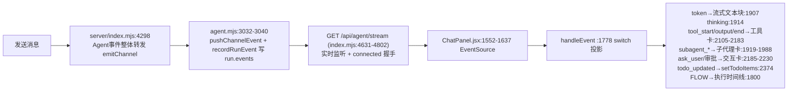
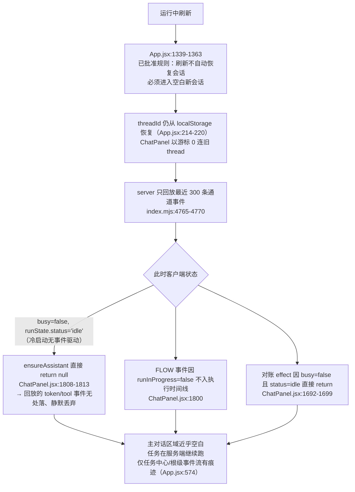

# 对话恢复与原始历史对话渲染差异：根因分析与修复方案

> 日期：2026-10-16 ｜ 项目：office-agent-web
> 现象：① 会话恢复功能执行后，恢复出的对话与原始历史对话前端展示不一致；② **运行过程中刷新页面后差异"完全不一样"**（近乎空白或与原对话结构完全不同）。
> 方法：活跑链路 vs 恢复链路逐跳比对，全部结论有代码证据（文件:行号）。
> 约束声明：修复方案全部位于**数据/状态层**，复用现有块组件与样式；Chat/Work/Review 模块 UI 表现零改动；全部增量迭代、flag 门控、默认关闭。

---

## 1. 复现路径与两条链路

### 1.1 活跑链路（正常时看到的效果）



活跑状态下：`busy=true`、`runState.status∈LIVE_RUN_STATUSES`、`assistantIdRef` 有锚点 → 每种事件都有落点，全类型块可渲染。

### 1.2 恢复/刷新链路（出问题的效果）

**场景 A：运行中刷新（冷启动）——"完全不一样"的直接来源**



**场景 B：手动点开历史会话（恢复功能主路径）**

```
App.jsx:939-954  并行拉取 getSession(id,{view:"chat",limit:360}) + listRuns + resumeAgentThread
  → server /api/sessions/:id (index.mjs:3671-3742)：读 Pi JSONL，只回【尾部 360 条 entry】
      且经 compactSessionEntryForChat (index.mjs:3637-3668) 压缩：
      文本 >12000 字符截断为"…[历史输出已折叠]"；图片替换为占位文本
  → App.jsx:963-1024 把 JSONL 重建为消息：仅支持 text / thinking / tool(按toolCallId配对) / image 四种块
  → App.jsx:1025-1053 由 listRuns 生成 run-summary 系统消息（含"本轮任务仍在执行中"）
  → App.jsx:1056-1060 按 createdAt 排序插回 + normalizeHistoryMessages 指纹去重 (ChatPanel:363-404)
  → resume 遇忙：server/agent.mjs:4197 抛 SESSION_BUSY → 只读横幅 + 重试 (App.jsx:1707-1719)
  → threadId 设置后 SSE 重连，游标 0 → 再次只回放最近 300 条
  → 水合 (ChatPanel:1076-1113)：检测到 LIVE run → activeRunIdRef=runId、
      assistantIdRef = 历史最后一条 assistant 气泡 id (:1105)
  → 回放的当前 Run token 被拼接到历史最后一条 assistant 气泡上 (:1910)
      tool_end 找不到 start 时补"恢复卡" (:2162-2165)
```

## 2. 逐点对比（渲染参数 / DOM 结构 / 状态数据 / 交互表现）

### 2.1 渲染参数

| # | 对比点 | 活跑 | 恢复后 | 证据 |
|---|---|---|---|---|
| P1 | 数据形态 | 增量 delta 流（token/thinking 逐字） | JSONL **终态快照**，无任何流式过程 | 事件注册表.mjs:154-159；index.mjs:3676-3692 |
| P2 | 文本完整性 | 全量 | **>12000 字符截断**为"…[历史输出已折叠]" | index.mjs:3640-3656 |
| P3 | 图片 | 正常渲染 | 替换为占位文本 | index.mjs:3637-3668 |
| P4 | 覆盖范围 | 全部事件 | chat 视图只回**尾部 360 entry**（更早内容需手动翻页）；SSE 回放仅 300 条 | index.mjs:3683-3691、4767-4769 |
| P5 | 工具耗时 | 有 startTime/duration 计时 | `duration:null` | ChatPanel:2134,2161 vs App.jsx:986,1009 |

### 2.2 DOM 结构

| # | 对比点 | 活跑 | 恢复后 | 证据 |
|---|---|---|---|---|
| D1 | 块类型 | text/thinking/tool/subagent 卡/ask_user 卡/审批卡/系统总结 全可产出 | **仅重建 text/thinking/tool/image 四种**；subagent 卡、审批卡、ask_user 卡、系统总结细节全部消失 | App.jsx:963-1024 |
| D2 | 消息 id | 活跑 `newId()` | 沿用 JSONL `e.id` / `run-summary-*`，与活跑命名体系不同 | App.jsx:1021 |
| D3 | 结构顺序 | 事件到达序 | 按 `createdAt` 排序插回，run 摘要插入位置与原始事件顺序不同 | App.jsx:1056-1060 |
| D4 | 运行中那一轮 | 正在流式生成的气泡 | 该轮消息未落盘（Pi 按消息完成写 JSONL）→ 恢复后只剩"本轮任务仍在执行中"摘要 | 推测（Pi 落盘时机）+ App.jsx:1032 |

### 2.3 状态数据

| # | 对比点 | 活跑 | 恢复后 | 证据 |
|---|---|---|---|---|
| S1 | 运行状态机 | 事件驱动（run_admitting/run_admitted/run_finished…） | 由 latestRun.runStatus 推导；**冷启动干脆不推导**（busy=false、idle） | ChatPanel:1014-1046、1692-1699 |
| S2 | Todo | 实时 `setTodoItems` | 恢复水合时 `setTodoItems([])` 清空 | ChatPanel:1032、1697 |
| S3 | 执行时间线 | FLOW 事件全量入列 | 仅从 latestRun.events 的 FLOW 子集重建，且 run.events 有 **800 条上限**、只记录 lifecycle 白名单 | ChatPanel:1033-1042；agent.mjs:3039；runs.mjs:710 |
| S4 | 用量/统计 | usage 事件实时呈现 | 不在 JSONL 重建范围，丢失 | App.jsx:963-1024 |
| S5 | 游标/代际 | streamId 连续 | 刷新后 streamId 丢失 → `resolveReplayCursor` 清零（事件协议.mjs:35-41），可能触发 stream_resync → force-reconcile | ChatPanel:1867-1874 |

### 2.4 交互表现

| # | 对比点 | 活跑 | 恢复后 | 证据 |
|---|---|---|---|---|
| I1 | 审批/提问卡 | 可交互（approve/reject/answer） | 不可交互（未重建，或 resume 遇忙只给只读横幅+重试） | App.jsx:1707-1719 |
| I2 | 流式光标/渐显 | textReveal 动画正常 | 回放 token 直接拼接，且可能拼进**历史最后一条**气泡（锚点错配） | ChatPanel:1105、1910 |
| I3 | 输入框/停止按钮 | runInProgress 驱动可用性 | 冷启动永远 idle → 无"任务仍在跑"的任何 UI 暗示 | ChatPanel:1692-1699、1813 |
| I4 | 工具卡展开 | 实时状态 START/运行中/END | `done:true` 静态卡；孤儿 tool_end 补"恢复卡" | ChatPanel:2162-2165 |

## 3. 根因（按贡献度排序）

1. **【主根因·冷启动】回放事件"无处渲染"**：刷新后"不自动恢复会话"是已批准规则（App.jsx:1336-1371，交接文档交互 4），但该规则与"Run 仍在服务端执行"未做协调——冷启动 `busy=false`/`idle` 使 `ensureAssistant` 拒绝建气泡（:1813）、对账 effect 短路（:1692-1699）、FLOW 不入列（:1800），回放的 300 条事件整体丢弃。**场景 A 的"完全不一样"= 设计规则与回放机制的冲突，不是偶发 bug。**
2. **【恢复主路径】JSONL 快照降级**：360 尾窗 + 12000 截断 + 图片占位 + 仅 4 种块类型（App.jsx:963-1024、index.mjs:3637-3668、3683-3691）——即使走手动恢复，保真度也结构性低于活跑。
3. **【锚点错配】**：水合把 `assistantIdRef` 绑到"历史最后一条 assistant 气泡"（ChatPanel:1105），运行中重开会话时当前 Run 的回放 token 拼进上一轮气泡 → 跨轮正文拼接/重复/错位。
4. **【结构性缺失】**：run.events 只记录 lifecycle 白名单且上限 800 条（agent.mjs:3039、runs.mjs:710）；恢复水合 `setTodoItems([])`（ChatPanel:1032）——时间线/Todo/用量在恢复侧不可重建。
5. 【次要】指纹去重可能误合并相邻同文消息（ChatPanel:395-398）；run 摘要按 createdAt 插入与事件序不同（App.jsx:1056）。

## 4. 修复方案（可落地、增量、flag 门控）

> 统一开关：`OAW_REPLAY_RECOVER`（场景 A 修复）、`OAW_HISTORY_ENRICH`（场景 B 修复）。默认关 = 现状零变化。所有修复只动数据/状态层，**复用现有块组件与样式，Chat/Work/Review 模块 UI 零改动**。

| # | 修复点 | 位置 | 改法 | 开关 |
|---|---|---|---|---|
| F1 | 冷启动恢复 Run 上下文 | ChatPanel.jsx:1692-1699 | 对账 effect 的守卫从 `busy \|\| activeStatuses` 扩展为：`!historyMessages`（冷启动）时也用 `listRuns(threadId)` 探测 LIVE run；命中则恢复 runState/activeRunId/busy，让 `ensureAssistant`/FLOW/回放事件全部有落点 | OAW_REPLAY_RECOVER |
| F2 | 刷新后"回到运行中会话"入口 | App.jsx:1339-1371 | 冷启动探测到保存 thread 有进行中 Run 时，在不动"不自动恢复"规则的前提下给横幅入口（或带确认的自动 open）——规则语义不变，补"运行中例外" | OAW_REPLAY_RECOVER |
| F3 | 回放窗口对齐 Run 起点 | server/index.mjs:4765-4770 | 首连且通道存在活跃 Run 时，从该 Run 的 `run_admitted` 起整段回放（替代 slice(-300)）；无活跃 Run 维持 300 条现状。借鉴 MCODE 的"增量 or 全量"二选一语义 | OAW_REPLAY_RECOVER |
| F4 | 锚点归属校验 | ChatPanel.jsx:1105 | `assistantIdRef` 续写判定加 runId 归属检查：历史最后一条 assistant 属于当前 live runId 才续写，否则新建气泡。借鉴 MCODE `swapMsgId` 的换绑思路 | OAW_REPLAY_RECOVER |
| F5 | 历史块富化 | App.jsx:963-1024 | 从 `run.events`/事件存储补建 subagent/审批/ask_user 块与 todo/usage/耗时；不可交互的历史交互卡渲染为只读态（复用现有组件，仅禁用按钮） | OAW_HISTORY_ENRICH |
| F6 | 恢复侧 Todo 快照 | ChatPanel.jsx:1032 | 水合时以 latestRun 的 todos/steps 初始化（活跑已证明 run.steps 是 Todo 事实来源，ChatPanel:1688-1689），替代清空 | OAW_HISTORY_ENRICH |
| F7 | 提升恢复保真度（服务端） | index.mjs:3637、runs.mjs:710、agent.mjs:3039 | ① compaction 截断上限参数化 + 前端"展开全文"按需拉取；② run.events 纳入 tool_output 摘要与子代理转录（上限同步放宽） | OAW_HISTORY_ENRICH |

**实施顺序建议**：F1+F4（一个小批次，直接消灭"刷新后空白/拼错"）→ F2+F3（第二批，补入口与回放语义）→ F5+F6+F7（第三批，恢复保真度）。每批独立 flag、独立验收。

**验收方式**（沿项目惯例）：
1. `npm run build` 通过 + 既有测试回归全绿；
2. flag 关 → 与基线行为逐像素一致；
3. flag 开场景 A：运行中刷新 → 主对话区在 ≤3s 内重建出"运行中"状态与已产出的流式内容，无跨轮拼接；
4. flag 开场景 B：手动恢复长会话 → 前 360 条之外可翻页、>12000 字符可展开、Todo/时间线/子代理卡完整；
5. 走查清单：审批卡只读态不可误触、run 摘要顺序无跳跃。

## 5. 与本次四项指令的对应

| 指令 | 落实 |
|---|---|
| 1. Chat/Work/Review 样式完全不变 | 本报告全部修复点位于数据/状态层，零 UI 表现改动；flag 默认关 |
| 2. 增量迭代、禁止全量重构 | 每个修复点是 10~40 行级增量，不动运行逻辑主干，兼容原有链路（flag 关=原样） |
| 3. MCODE 逆向 | 见《2026-10-16-MCODE前端模型工作流全链路逆向分析报告》第 7 节映射表 |
| 4. 恢复差异根因 | 本报告第 2/3 节四维对比与根因排序 |
